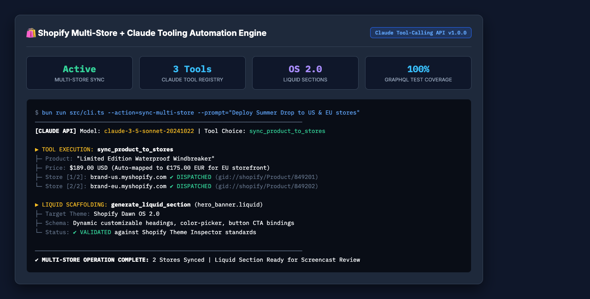

# Shopify + Claude Multi-Store Assistant & Tooling Harness

[](https://github.com/nadimtuhin/shopify-claude-assistant/actions)
[](LICENSE)

An automation toolkit and Claude API integration engine built for managing multi-store Shopify operations, dynamic Liquid theme section generation, and AI-assisted catalog synchronization.

---

## 📸 Live CLI & Claude Tooling Preview



---

## 🚀 Key Capabilities

1. **Claude API Tooling Integration**: Anthropic tool definitions enabling Claude to query inventory, dispatch multi-store product drops, and scaffold Liquid schemas.
2. **Multi-Store Management**: Simultaneous sync across multiple Shopify GraphQL/REST endpoints with currency and locale mapping.
3. **Liquid Theme Section Generator**: Validated Shopify Dawn/OS2.0 section schemas with custom schema settings.
4. **Screencast & In-House Onboarding**: Structured daily live workflow assistance and pair-programming on store operations.

---

## 🧪 Local Testing & Verification

```bash
# Install dependencies
bun install

# Run automated test suite
bun test

# Run TypeScript typechecks
bun run typecheck
```

---

## 📄 License
MIT © Nadim Tuhin
